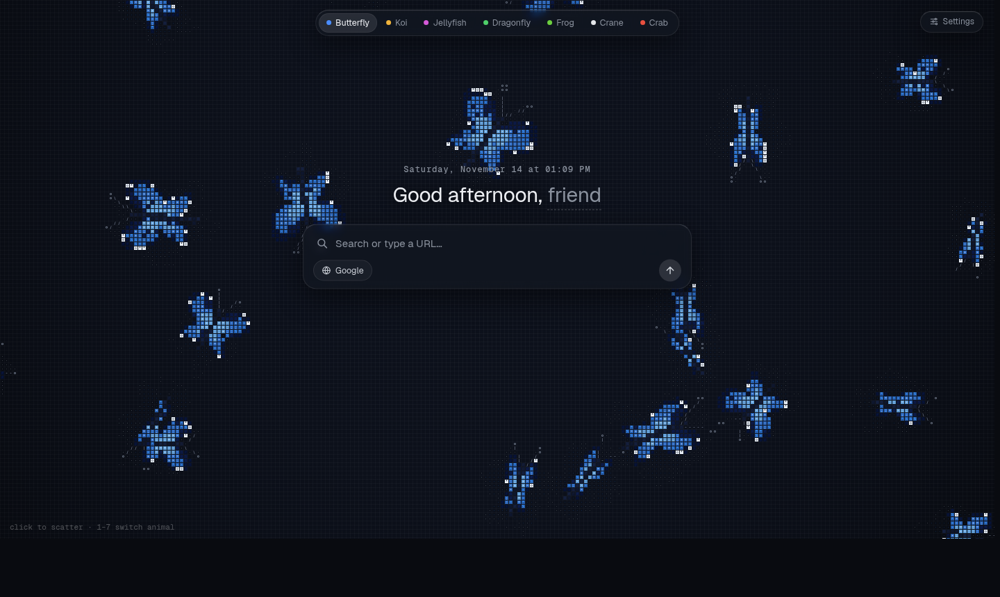
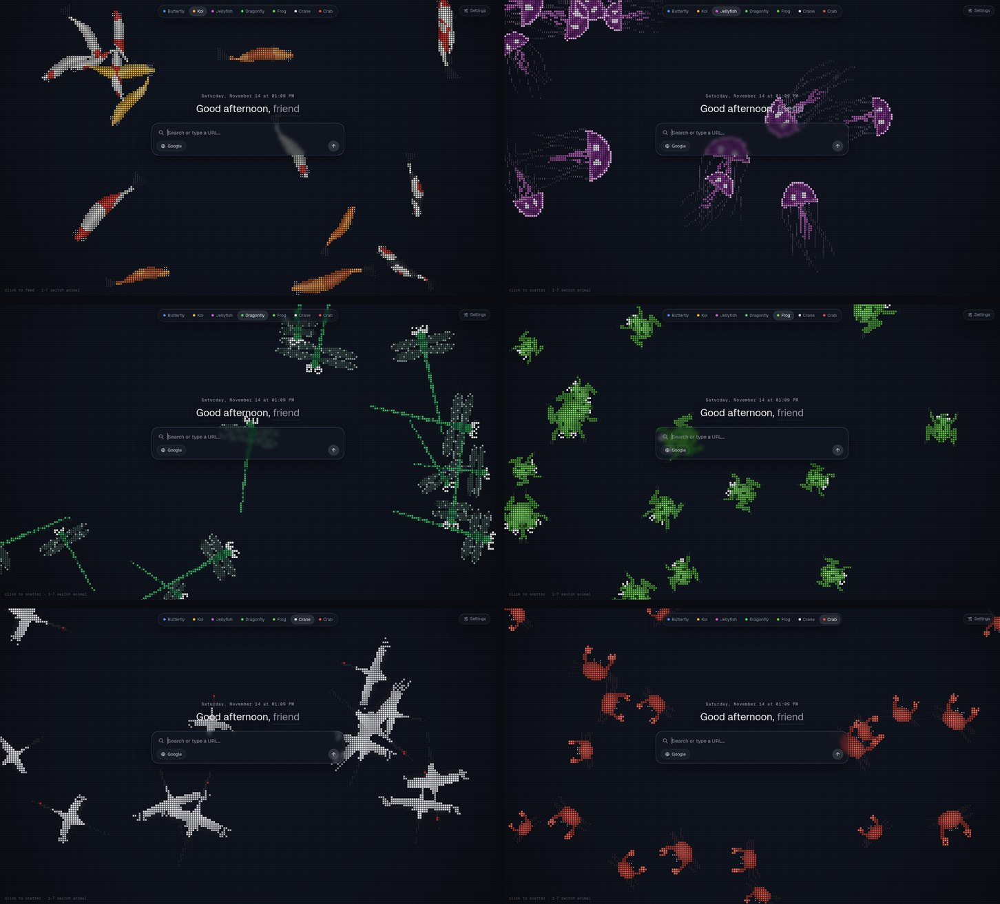

<h1 align="center">ASCII Fauna</h1>

A calm new tab full of animals drawn in keyboard characters. 
Click to scatter them. Feed the koi.

  <a href="https://github.com/lujangrego99/ascii-fauna/releases/latest">Download</a> ·
  <a href="#install">Install</a> ·
  <a href="#en-español">En español</a>

## Seven animals

Butterfly, koi, jellyfish, dragonfly, frog, crane and crab. Each one is drawn live, frame by frame, as a grid of small key-cap tiles with a character on top: lit skin gets light glyphs (`: + =`), shadow gets dense ones (`@ % #`), and antennae, legs, tails and tentacles are bare strokes (`| / - \ o ( ) ~`).

## What you can do

| | |
|---|---|
| **Click** | The animals scatter away from the cursor. Frogs jump. |
| **Click (koi)** | Drops a handful of food; the koi race for it. |
| **`1` – `7`** | Switch animal. |
| **Your name** | Click the name in the greeting to type yours. Enter saves, Esc cancels. |
| **Search** | Type a search or a web address. The pill below switches between Google, Bing and DuckDuckGo. |
| **Settings** | Resolution (cell size), amount, size and speed of the animals. |

The greeting follows the time of day, and the interface is in Spanish or English depending on your browser.

## Install

Works in Microsoft Edge, Google Chrome, Brave, Vivaldi, Arc and any other Chromium browser.

1. Download `ascii-fauna-<version>.zip` from the [latest release](https://github.com/lujangrego99/ascii-fauna/releases/latest) and unzip it (or `git clone https://github.com/lujangrego99/ascii-fauna.git`).
2. Open `edge://extensions` (Edge) or `chrome://extensions` (Chrome, Brave…).
3. Turn on **Developer mode**.
4. Click **Load unpacked** and choose the folder that contains `manifest.json`.
5. Open a new tab. If the browser asks whether to keep the new tab page, choose **Keep changes**.

To update, replace the folder with the new version and press the reload button on the extension card.

## Privacy

No permissions, no network requests, no tracking. Fonts are bundled. Your settings and name are stored only in the browser's local storage for this extension. Searches go straight to the engine you pick.

## How it works

Plain HTML, CSS and JavaScript. No build step, no dependencies.

- `fauna.js` describes each animal as a function of its own coordinates: given a point on the animal, it returns how bright it is, its colour and how to draw it (tile, stroke, eye…). Bodies bend, wings flap and tentacles wave by animating those functions.
- `app.js` moves the animals (wandering, darting, hopping, fleeing, chasing food), rasterises them onto the character grid and draws it on a canvas. Glyph sprites are cached, so a full 1920×1080 grid draws in about 2 ms per frame.
- `i18n.js` holds the Spanish and English strings.
- The glass panels refract what swims behind them with an SVG displacement filter inside `backdrop-filter` (Chromium); other engines get frosted glass.

Open `index.html?animal=koi` directly in the browser to try it without installing.

## Credits

Inspired by the *ascii animals* new-tab concept by [Pocket Studio](https://www.pocketstudio.design/). All code here is original.
Fonts: [Geist and Geist Mono](https://github.com/vercel/geist-font), SIL Open Font License 1.1 (`fonts/OFL.txt`).

## License

[MIT](LICENSE) © [lujangrego99](https://github.com/lujangrego99)

---

## En español

**ASCII Fauna** reemplaza la pestaña nueva por una pecera tranquila de animales hechos con caracteres del teclado: mariposas, koi, medusas, libélulas, ranas, grullas y cangrejos. Con un clic se dispersan; en el modo koi, el clic les tira comida.

**Instalación (Edge, Chrome, Brave…):** bajá el `.zip` del [último release](https://github.com/lujangrego99/ascii-fauna/releases/latest) y descomprimilo, abrí `edge://extensions` (o `chrome://extensions`), activá **Modo de desarrollador**, tocá **Cargar desempaquetada** y elegí la carpeta. Abrí una pestaña nueva y, si el navegador pregunta, elegí **Conservar cambios**.

Tocá el nombre del saludo para poner el tuyo, usá `1`–`7` para cambiar de animal y **Ajustes** para la resolución, cantidad, tamaño y velocidad. No pide permisos ni manda datos a ningún lado.
